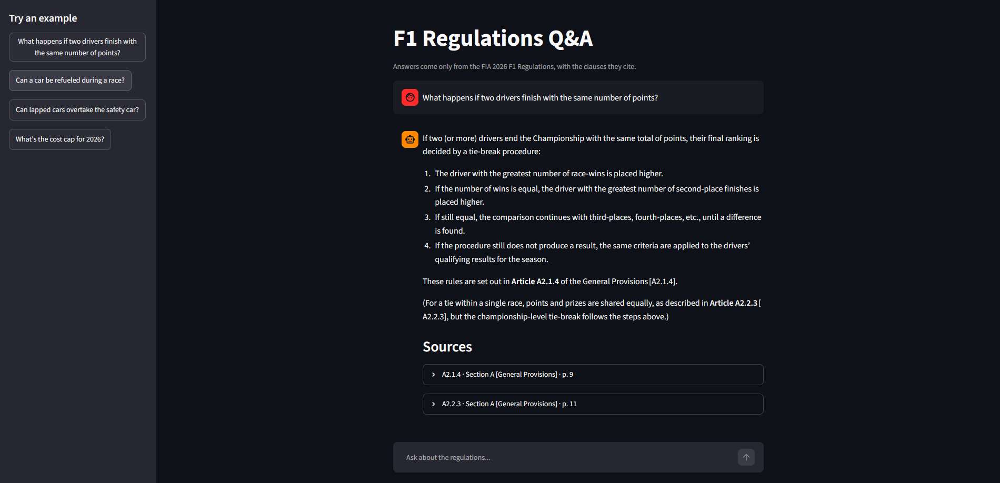

# F1 Regulations RAG
 
A retrieval-augmented question-answering system over the **FIA 2026 Formula 1 Regulations** (Sections A-F). Ask a question in plain language and get an answer grounded in the regulations, with the clause IDs, document and page it came from.
 
**Live demo: https://f1-regulations-rag.streamlit.app/**
The free host puts apps to sleep after 12 hours without traffic, so the first load can take a minute.


 
> **Status:** deployed and working end to end. Retrieval is measured (see below); answer quality has only been checked by hand so far, and automated answer evaluation is next. See the [Roadmap](#roadmap).

 
## How it works
 
```
PDFs -> pages -> clauses -> embeddings -> Qdrant
                                            |
question -> embed -> top-10 clauses -> prompt -> LLM -> answer + citations
```
 
| Stage | What it does | Implementation |
|---|---|---|
| Ingestion | Reads every PDF into page records (`source`, `page`, `text`) | PyMuPDF |
| Chunking | Splits the text into one chunk per numbered clause (`A2.1.4`, `C6.4.4`, ...) | regex on clause IDs |
| Embeddings | Embeds each clause together with its parent section title | `BAAI/bge-small-en-v1.5` (CPU, normalized) |
| Vector DB | Stores vectors plus metadata (document, clause ID, parent title, page, text) | Qdrant: Cloud in the deployed app, a local folder for development |
| Retrieval | Dense similarity search, top 10 clauses | Qdrant cosine search |
| Prompt | Numbered clauses as context; the model may only use them and must cite clause IDs | `src/prompts` |
| LLM | Generates the answer at temperature 0 | Groq, `gpt-oss-120b` |
| Citations | Built from stored metadata, not from the model's text | `src/rag.py` |
 
### Design decisions
 
- **Chunk by clause, not by page or fixed length.** Each clause is a self-contained rule and the unit people cite, so a retrieved chunk maps directly to a precise citation. Fixed-size chunks would cut rules in half.
- **Parent section title is embedded with each clause.** A clause like "Only wind tunnels that use air at atmospheric pressure are permitted" does not mention what it is about; its section title ("RWTT Permitted technology") does.
- **Citations come from metadata.** The model only supplies clause IDs. Document name and page are looked up from what was retrieved, and any ID the model cites that was not in its context is flagged as `unverified_citations`.
- **Index pages and appendices are excluded.** The table of contents is skipped per PDF (hardcoded page counts), and chunking stops at an `APPENDIX` heading so the last clause does not swallow the definitions.
## Retrieval evaluation
 
A hand-written set of 13 questions, each paired with the clause that answers it, covering Sections A-E. The metric is recall@k: how often the expected clause is among the top k retrieved.
 
| Configuration | recall@3 | recall@5 | recall@10 |
|---|---|---|---|
| **Dense only (used)** | **0.69** | **0.77** | **0.92** |
| Dense + cross-encoder rerank (`bge-reranker-base`) | 0.54 | 0.62 | 0.85 |
| Hybrid (dense + BM25, RRF fusion) | 0.62 | 0.69 | 0.85 |
| Hybrid + rerank | 0.54 | 0.54 | 0.77 |

> bge-base-en-v1.5
 
| Configuration | recall@3 | recall@5 | recall@10 |
|---|---|---|---|
| **Dense only (used)** | **0.69** | **0.85** | **1.0** |
| Dense + cross-encoder rerank (`bge-reranker-base`) | 0.62 | 0.62 | 0.77 |
| Hybrid (dense + BM25, RRF fusion) | 0.62 | 0.62 | 0.92 |
| Hybrid + rerank | 0.54 | 0.54 | 0.69 |

> bge-small-en-v1.5

Plain dense retrieval won at every k, so BM25 and the reranker are implemented but switched off. Each question is worth about 8 points, so treat differences of one or two questions with caution; the set should grow before drawing fine conclusions.
 
## Project structure
 
```
src/
  ingestion/    PDF -> page records, plus per-PDF index page counts
  chunking/     pages -> clause chunks
  embeddings/   embedding model wrapper
  vectordb/     Qdrant collection build and client
  retrieval/    dense search (optional BM25 hybrid and reranker)
  prompts/      system prompt and context formatting
  llm/          Groq client
  rag.py        ask(): retrieve -> prompt -> generate -> sources
  scripts/      build_index, CLI chat loop and retrieval evaluation
app.py          Streamlit UI
tests/          pytest tests for the chunker
documents/      the FIA regulation PDFs (input)
```

 
## Getting started
 
Requirements: Python 3.12 and a [Groq](https://console.groq.com) API key. No separate database server is needed.
 
```bash
python -m venv .venv
.venv\Scripts\activate            # Windows
pip install -r requirements-dev.txt    # requirements.txt alone is enough to run the app
```
 
1. Put the regulation PDFs in `documents/`.
2. Create a `.env` file in the project root:
```
   GROQ_API_KEY=your_key_here
```
3. Build the index. Qdrant runs inside the Python process and saves to the `qdrant_data/` folder, so there is nothing to start. This embeds all clauses and stores them there (about 4 minutes on CPU). Run it again whenever you change the chunker or the embedding model:
```bash
   python -m src.scripts.build_index
```

 
## Usage
 
Web app (each cited clause expands to show the full rule text):
 
```bash
streamlit run app.py
```
 
Interactive question loop in the terminal (the embedding model loads once, then each question is fast):
 
```bash
python -m src.scripts.ask
```
 
Each answer prints the cited clauses with their document and page, plus a warning if the model cited a clause that was not in its context.
 
Retrieval evaluation (recall@k for the dense, hybrid and reranked configurations):
 
```bash
python -m src.scripts.eval_retrieval
```
 
Run the chunker tests:
 
```bash
pytest -v
```

 
## Known limitations
 
- Questions are answered independently; there is no conversation memory, so follow-ups like "and for the sprint?" do not work yet.
- The appendices with general definitions are not indexed. Definitions are not numbered clauses and need their own chunking (one chunk per term).
- Citations name the document, clause ID, parent section and page. The `ARTICLE` heading names (for example "A5: General roles and responsibilities") are not captured as metadata yet.
- Page headers and footers are not stripped from the text, and a clause that crosses a page break can carry that noise.
- Index page counts are hardcoded per PDF, so a new issue of a document needs its entry updated.
- The evaluation covers retrieval only, with 13 questions. Answer quality has been read by hand, not measured.
- The demo shares one Groq key, so heavy use can hit rate limits.
- In local mode, Qdrant allows only one process to open `qdrant_data/` at a time, so the app, the chat loop and the evaluation script cannot run together. Using Qdrant Cloud removes this.

## Roadmap
 
- [ ] Measure answer quality with RAGAS (faithfulness, answer relevancy) plus a deterministic check that the expected clause is cited
- [ ] Index the definitions appendices, one chunk per term
- [ ] Capture article names as metadata and show them in citations
- [ ] Strip repeated headers and footers before chunking
- [ ] Grow the evaluation set and add out-of-scope questions (the bot should answer that the regulations do not cover them)
- [x] Deploy the Streamlit app (Qdrant Cloud for the vectors; test `bge-small` to fit a free host)
- [ ] Optional: conversation memory for follow-up questions
- [ ] Optional: FastAPI `POST /ask` endpoint returning the answer and its sources (the UI calls `ask()` directly)